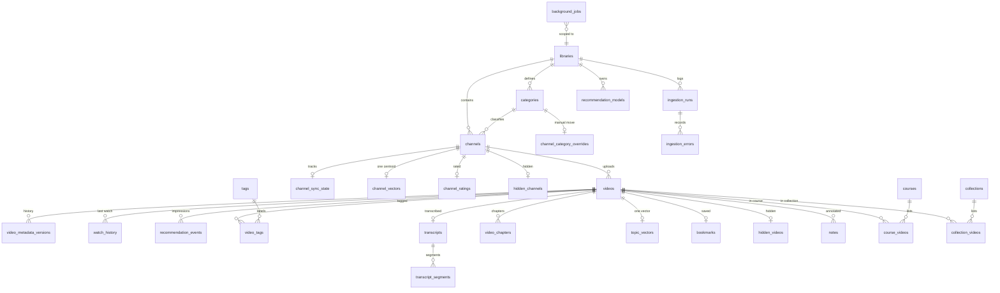

# 03 — Database design

Target: SQLite 3.35+ (the fleet Python 3.12+ ships newer), WAL mode, `foreign_keys=ON`.
All `*_at` columns are **INTEGER epoch milliseconds (UTC)** to match the frontend's `Date.now()`
and to serialise to JSON without timezone ambiguity. Booleans are `INTEGER 0/1`.
Money-free, timezone-free, no floats where an integer will do.

---

## 1. ER diagram (core + user state)



`channel_category_overrides` is a 1:1 side table rather than a `is_override` flag on `channels`
so that "the classifier says X" and "the user says Y" both stay readable, and a classifier re-run
can never silently discard a manual move.

## 2. Tables

Notation: `PK` primary key, `FK` foreign key, `UQ` unique, `NN` not null.

### Identity and structure

| Table | Columns | Notes |
|---|---|---|
| `libraries` | `id` PK, `name` NN, `source_path`, `per_channel` NN default 50, `created_at` NN, `updated_at` NN, `is_active` NN default 1 | one row today; the column exists so a second export can be imported side-by-side and compared |
| `categories` | `id` PK, `library_id` FK→libraries CASCADE, `slug` NN, `name` NN, UQ(`library_id`,`slug`) | seeded from `app/resources/categories.json` |
| `channels` | `id` PK, `library_id` FK CASCADE, `yt_id` NN UQ, `name` NN, `url`, `handle`, `avatar_url`, `description`, `subscriber_count`, `category_id` FK→categories SET NULL, `first_seen_at` NN, `last_seen_at` NN | `yt_id` unique **globally**: a channel cannot belong to two libraries in this design; documented limitation |
| `channel_category_overrides` | `channel_id` PK FK CASCADE, `category_id` FK CASCADE, `updated_at` NN | presence wins over `channels.category_id` |
| `videos` | `id` PK, `channel_id` FK CASCADE, `yt_id` NN UQ, `title` NN, `duration_s` NULL, `view_count` NULL, `published_at` NULL, `thumbnail_url` NULL, `description` NULL, `is_available` NN default 1, `metadata_hash` NN, `first_seen_at` NN, `last_seen_at` NN, `extra_json` NULL | `yt_id` unique mirrors real YouTube ids and makes sync idempotent |
| `video_metadata_versions` | `id` PK, `video_id` FK CASCADE, `captured_at` NN, `metadata_hash` NN, `title`, `duration_s`, `view_count`, `changed_fields` | append-only; retention keeps last 5 per video |

### Ingestion and sync

| Table | Columns | Notes |
|---|---|---|
| `channel_sync_state` | `channel_id` PK FK CASCADE, `status` NN (`never`,`ok`,`failed`,`partial`,`throttled`), `last_attempt_at`, `last_success_at`, `last_error_stage`, `last_error`, `consecutive_failures` NN default 0, `next_attempt_at` | drives exponential backoff; a failed channel never touches other rows |
| `ingestion_runs` | `id` PK, `library_id` FK CASCADE, `kind` NN (`csv_import`,`json_import`,`full_sync`,`channel_refresh`), `status` NN (`running`,`ok`,`partial`,`failed`,`cancelled`), `started_at` NN, `finished_at`, `channels_ok` NN 0, `channels_failed` NN 0, `videos_seen` NN 0, `videos_new` NN 0, `videos_updated` NN 0, `job_id`, `notes` | one row per attempt; survives crashes as `running` and is closed by recovery |
| `ingestion_errors` | `id` PK, `run_id` FK CASCADE, `channel_yt_id`, `stage` NN, `message` NN, `retryable` NN, `created_at` NN | retention 30 days |

### Jobs

| Table | Columns | Notes |
|---|---|---|
| `background_jobs` | `id` PK TEXT (uuid4 hex), `type` NN, `status` NN (`queued`,`running`,`ok`,`failed`,`cancelled`), `priority` NN default 5 (lower first), `created_at` NN, `started_at`, `finished_at`, `progress` REAL 0..1, `stage`, `payload_json` NN, `result_json`, `error`, `attempts` NN 0, `max_attempts` NN 3, `cancel_requested` NN 0, `worker_id`, `heartbeat_at`, `dedupe_key` | partial unique index `(type, dedupe_key) WHERE status IN ('queued','running')` prevents duplicate concurrent work |
| indexes | `ix_jobs_claim (status, priority, created_at)`, `ix_jobs_stale (status, heartbeat_at)` | claim is `UPDATE … WHERE id = (SELECT … ORDER BY priority, created_at) RETURNING *` |

### User state (migrated from `mytube-*`)

| Table | Columns | Notes |
|---|---|---|
| `watch_history` | `video_id` PK FK CASCADE, `watched_at` NN, `engagement` REAL NN default 1.0, `position_s` REAL, `completed` NN 0 | one row per video, matching the frontend; `engagement` = 1.4 ended, else `clamp(s/120, 0.3, 1.3)` |
| `recommendation_events` | `id` PK, `video_id` FK SET NULL, `kind` NN (`impression`,`click`,`not_interested`,`undo`), `surface`, `position`, `at` NN, `meta_json` | append-only; retention 90 days; powers shelf statistics |
| `channel_ratings` | `channel_id` PK FK CASCADE, `rating` NN CHECK 1..5, `updated_at` NN | |
| `hidden_channels` / `hidden_videos` / `hidden_categories` | `*_id` PK, `hidden_at` NN | separate tables keep the "why" explicit and let the library stay untouched |
| `user_preferences` | `key` PK, `value_json` NN, `updated_at` NN | `reco` knobs, `filters`, `theme`, `autoplay`, `ranker` state |
| `courses` | `id` PK TEXT, `name` NN, `created_at` NN, `updated_at` NN, `archived` NN 0 | id is the frontend's existing string id, preserved through migration |
| `course_videos` | `course_id` FK CASCADE, `video_id` FK CASCADE, `position` NN, PK(`course_id`,`video_id`) | |
| `collections` | `id` PK TEXT, `name` NN, `kind` NN default `'collection'`, `created_at` NN | research collections / playlists |
| `collection_videos` | `collection_id`, `video_id`, `position`, PK(pair) | |
| `notes` | `id` PK, `video_id` FK SET NULL, `course_id` FK SET NULL, `body` NN, `timestamp_s` NULL, `created_at` NN, `updated_at` NN | deleting a course must not delete videos or notes |
| `bookmarks` | `video_id` PK FK CASCADE, `created_at` NN | |
| `tags` / `video_tags` | `id` PK, `name` NN UQ / (`video_id`,`tag_id`) PK | |

### Content enrichment (optional, off by default)

| Table | Columns |
|---|---|
| `transcripts` | `id` PK, `video_id` FK CASCADE UQ, `language`, `source`, `text` NN, `fetched_at` NN |
| `transcript_segments` | `id` PK, `transcript_id` FK CASCADE, `start_s` NN, `end_s` NN, `text` NN |
| `video_chapters` | `id` PK, `video_id` FK CASCADE, `start_s` NN, `title` NN |

### Recommendation system

| Table | Columns | Notes |
|---|---|---|
| `topic_vectors` | `video_id` PK FK CASCADE, `model_id` NN, `dim` NN, `vector` BLOB NN, `norm` REAL NN | 64 × float32 = 256 B; 58,903 rows ≈ 15 MB, matching the browser's `Float32Array` budget |
| `channel_vectors` | `channel_id` PK FK CASCADE, `model_id` NN, `dim`, `vector` BLOB, `norm` | channel centroid |
| `recommendation_models` | `id` PK, `kind` NN (`ranker`,`candidates`,`reranker`), `version` NN, `weights_json` NN, `config_json`, `metrics_json`, `trained_at` NN, `is_active` NN 0, UQ(`kind`,`version`) | BPR output lands here; the API reads the active row |
| `recommendation_experiments` | `id` PK, `name` NN, `config_json` NN, `results_json`, `status` NN, `started_at` NN, `finished_at` | reproducible offline evaluation |
| `shelf_statistics` | `id` PK, `shelf` NN, `day` NN, `impressions` NN, `clicks` NN, UQ(`shelf`,`day`) | CTR per shelf |

### Operations

| Table | Columns |
|---|---|
| `backups` | `id` PK, `kind` (`sqlite`,`json_state`), `path` NN, `bytes` NN, `sha256` NN, `created_at` NN, `verified_at`, `status` (`ok`,`failed`) |
| `schema_version` | `version` PK, `applied_at` NN | mirrors Alembic head for a cheap `GET /health` check |

## 3. Index set and why

```sql
CREATE INDEX ix_channels_library_name   ON channels(library_id, name);
CREATE INDEX ix_channels_category       ON channels(category_id);
CREATE INDEX ix_videos_channel_recent   ON videos(channel_id, published_at DESC, id DESC);
CREATE INDEX ix_videos_recent           ON videos(published_at DESC, id DESC);
CREATE INDEX ix_videos_duration         ON videos(duration_s) WHERE duration_s IS NOT NULL;
CREATE INDEX ix_history_watched         ON watch_history(watched_at DESC);
CREATE INDEX ix_events_video            ON recommendation_events(video_id, at DESC);
CREATE INDEX ix_events_kind_at          ON recommendation_events(kind, at DESC);
CREATE INDEX ix_jobs_claim              ON background_jobs(status, priority, created_at);
CREATE UNIQUE INDEX uq_jobs_active_dedupe ON background_jobs(type, dedupe_key)
    WHERE status IN ('queued','running') AND dedupe_key IS NOT NULL;
CREATE INDEX ix_sync_due                ON channel_sync_state(status, next_attempt_at);
```

- `ix_videos_channel_recent` serves channel pages (`WHERE channel_id=? ORDER BY published_at DESC`)
  as a covering range scan; with 60k rows and ~41 rows per channel it is a few page reads.
- `ix_videos_recent` serves the global "newest" shelf; it stays useful at 600k rows.
- The partial index on `background_jobs` is what makes "never run two full syncs" a database
  guarantee rather than a code convention.
- FTS5: `video_fts(title, channel_name, description)` kept in sync by triggers on `videos`
  (§4), queried with `bm25(video_fts)` and `snippet()`. At 60k documents the index is ~12 MB.

## 4. FTS5 maintenance

```sql
CREATE VIRTUAL TABLE video_fts USING fts5(
    title, channel_name, description,
    tokenize = "unicode61 remove_diacritics 2"
);

CREATE TRIGGER videos_ai AFTER INSERT ON videos BEGIN
  INSERT INTO video_fts(rowid, title, channel_name, description)
  VALUES (new.id, new.title,
          (SELECT name FROM channels WHERE id = new.channel_id),
          coalesce(new.description, ''));
END;

CREATE TRIGGER videos_au AFTER UPDATE OF title, description, channel_id ON videos BEGIN
  DELETE FROM video_fts WHERE rowid = old.id;
  INSERT INTO video_fts(rowid, title, channel_name, description)
  VALUES (new.id, new.title,
          (SELECT name FROM channels WHERE id = new.channel_id),
          coalesce(new.description, ''));
END;

CREATE TRIGGER videos_ad AFTER DELETE ON videos BEGIN
  DELETE FROM video_fts WHERE rowid = old.id;
END;
```

Triggers rather than application code because a channel rename must re-index every one of its
videos, and `UPDATE channels SET name` cannot be relied on to remember that.

## 5. Integrity, cascades, retention

- Every child of `videos`/`channels` cascades, so deleting a channel cannot leave orphan ratings.
- `notes.video_id` and `recommendation_events.video_id` are `SET NULL`: deleting a video must not
  delete the user's writing or the analytics row.
- `CHECK` constraints: `channel_ratings.rating BETWEEN 1 AND 5`, `videos.duration_s > 0 OR NULL`,
  `background_jobs.progress BETWEEN 0 AND 1`, `watch_history.engagement BETWEEN 0 AND 5`.
- Retention (a `maintenance` job, not a trigger): events > 90 days, errors > 30 days,
  metadata versions > 5 per video, backups > 10 files.
- `PRAGMA integrity_check` runs in `/diagnostics` and before every restore.

## 6. Scale to hundreds of thousands

| Rows | Effect |
|---|---|
| 60k videos | all queries above < 25 ms |
| 300k videos | `ix_videos_recent` still a range scan; FTS grows to ~60 MB; `topic_vectors` to ~77 MB |
| 1M videos | recommendations must move from in-Python scan to FTS/ANN candidate limits (the interface already returns a bounded candidate list); the schema does not change |

The only structural change anticipated is a `video_stats_daily` table for view-count history, and
`channels.yt_id` uniqueness relaxing if multi-library import becomes real. Both are additive
migrations, no data rewrite.

## 7. Migration strategy

Alembic, one linear chain, `render_as_batch=True`. Revision 0001 creates §2 + §4 in a single
transaction. Importing existing `videos.json` is **not** a migration — it is data seeding via
`app.services.importer`, so a fresh install and a migrated install take the same code path.
Downgrade path: every revision implements `downgrade()`; destructive ones drop only tables added
by that revision.
