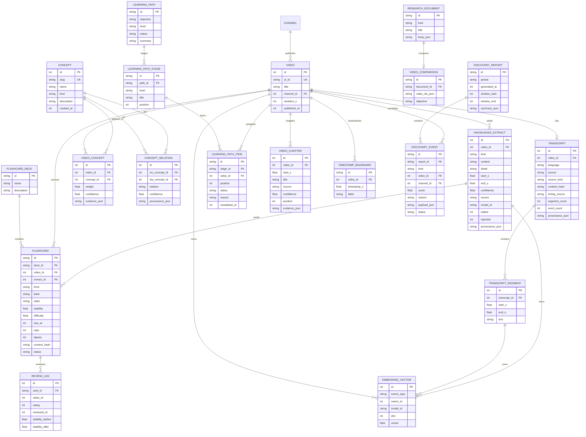

# My Tube 3.0 — Intelligence Architecture and Data Model

## 1. Goals and constraints

My Tube remains a **local-first, subscription-only** video library. The intelligence
layer is additive: it reads the existing `videos`, `channels`, `watch_history`,
`watch_sessions`, `user_preferences` and recommendation code; it does not replace the
recommendation engine, the static frontend or the existing localStorage behavior.

Non-negotiables implemented here:

- Only imported subscription-library videos are candidates for every feature.
- No proprietary API, paid SaaS, telemetry or mandatory cloud.
- AI is optional; every feature has a deterministic fallback.
- No invented videos, quotes, timestamps, relationships or viewing history.
- Every derived row keeps source provenance and confidence where applicable.
- SQLite + SQLAlchemy + Alembic + FTS5 remain the foundation.

## 2. Layer map

```
site/index.html                  vanilla JS workspace; existing views preserved
        │  /api/v1/* (fetch, loopback)
        ▼
app/api/intelligence.py          additive REST surface, validation, error mapping
        │
        ├── services/ai/                 embedding + local LLM provider abstraction
        ├── services/knowledge/          text, transcripts, extraction, index, graph, ask, compare
        ├── services/learning/           FSRS-5 flashcards, prerequisite-ordered paths
        ├── services/video/              chapters/navigation/bookmarks, perspectives
        ├── services/analytics/          exposure/engagement/completion/revision timeline
        ├── services/discovery/          subscription-only radar + reports
        └── services/intelligence_jobs.py background job handlers
        │
        ▼
app/db/models.py                 additive ORM entities
app/db/intel_fts.py              transcript_fts / knowledge_fts
app/db/engine.py                 migrate() + additive-column guard
migrations/versions/003_intelligence.py
```

The existing `app/api/v1.py`, `app/services/recommendations.py`, importer, search,
history and job services are reused rather than duplicated. Perspectives calls the
existing `recommend()`; paths reuse `search_videos()` as a fallback; Ask reuses the
existing FTS index plus the new intelligence FTS.

## 3. Shared processing flow

```
captions / user-supplied text / local ASR output
        │
        ▼  ingest_transcript (normalize, hash, validate timing)
transcripts + transcript_segments + transcript_fts
        │
        ├── extract_knowledge (deterministic; optional local LLM with citation validation)
        │       ├── summaries, definitions, terms, examples, formulas, code, timestamps
        │       ├── prerequisites, generated questions, flashcard seeds
        │       └── concepts + concept relations + video_concept links
        │
        ├── embeddings (deterministic hash vectors or opted-in sentence-transformers)
        │       └── embedding_vectors (video/transcript/extract/concept owners)
        │
        ├── chapters (only when timing_source = supplied)
        ├── flashcards (from stored seeds, FSRS state)
        ├── graph / Ask / comparison / paths / radar (read the same rows)
        └── analytics (reads watch/review/creation events, never invents them)
```

### Idempotency and reprocessing

- Transcripts are keyed by `video_id` and a normalized `content_hash`; identical input
  is a no-op unless `force=true`.
- Every model/algorithm identity is recorded (`model_id`, provenance JSON), so changing
  the embedding model can be detected and re-indexed.
- Extraction rows carry `source`, `model_id`, `edited`, `rejected`, `provenance_json`.
  Regeneration never overwrites a row marked `edited`; `regenerate_extract()` creates a
  replacement for non-edited rows.
- Auto-generated chapters delete only prior `source='generated'` rows.
- Embeddings are upserted by `(owner_type, owner_id, model_id)` so re-indexing is incremental.
- Jobs use dedupe keys and are cancellable/retryable through the existing job service.

## 4. Design decisions (ADR summary)

1. **Deterministic embeddings by default.** A 256-dim signed hashing vectorizer
   (`mytube-hash-v1`) works offline with no model download. Optional
   `sentence-transformers` is used only if already installed and selected via
   `MYTUBE_EMBEDDING_MODEL`. This satisfies “no mandatory AI” and keeps semantic search
   available on any CPU.
2. **Small, inspectable retrieval pipeline instead of Haystack/LlamaIndex.** FTS5 +
   hashed vectors + reciprocal-rank fusion + optional local LLM is enough, easier to
   audit, and avoids overlapping frameworks.
3. **No LLM by default.** `MYTUBE_AI_ENABLED=1` (or the UI model selection) is required.
   Only loopback endpoints are allowed unless `MYTUBE_ALLOW_REMOTE_AI=1`. LLM output is
   accepted only when every `[n]` citation maps to a supplied source; otherwise the
   extractive answer is shown with a note.
4. **Truthful chapters.** Generated chapters require `timing_source='supplied'`; untimed
   transcripts return `available:false` with a reason. Rows are labelled
   `authored_by:"auto_generated"`, never “creator”.
5. **FSRS-5 in stdlib.** Review history is independent of videos (`review_logs` keeps
   card/video ids but survives card/video deletion via explicit restore/export paths).
6. **Graph provenance.** Every edge has `confidence` and a provenance object; “similar”
   edges come only from stored embeddings; concept relations come from stored extraction.
7. **Perspectives calls the existing recommender.** `DEFAULT_W`, `app.domain.weights`,
   BPR and MMR are untouched. The eight categories explain why a subscription-library
   video is shown; results are deduped and capped per channel.
8. **Radar scans the library, not the web.** Every event is persisted with a reason,
   score and status; the scheduler is a job, not an always-on daemon, and can be
   disabled/paused.
9. **Analytics never equates watching with mastery.** Exposure, engagement, completion,
   revision and a Good/Easy retention proxy are separate fields; inferred topic shifts
   include the counts and buckets that produced them.

## 5. Entity-relationship diagram



Additional operational tables: `background_jobs`, `processing_provenance`, `model_configs`,
`pipeline_configs`, `user_preferences` (radar config, playback mode), and the existing
library/history tables. `processing_provenance` is intentionally generic
(`entity_type`, `entity_id`, `step`, `model_id`, hashes, timestamp) so any stage can be
audited without adding a column per feature.

## 6. Migration and compatibility

- Fresh databases use `Base.metadata.create_all` plus FTS creation.
- Existing databases go through `Database.migrate()`: additive `ALTER TABLE` calls in
  `_ensure_intelligence_columns()` and FTS table creation.
- Alembic revision `003_intelligence` mirrors the additive schema changes; it does not
  drop or rewrite existing data.
- Legacy columns and routes are retained. New API routes are namespaced under
  `/api/v1` and do not change existing response contracts.
- The only modification to existing runtime behavior is a bug fix in `app/main.py`:
  the lifespan now honors `app.state.settings`, so a caller-supplied database path is
  actually used (tests and embeddings). The default uvicorn path is unchanged.

## 7. Performance and scale notes

- FTS5 indexes transcript segments and extracts; queries are limited and ranked.
- Embedding indexing is incremental and batchable through `embedding_index` jobs.
- Graph queries cap concepts/nodes (`limit`) and only join stored links.
- Radar loads available videos for scoring; for a 100k+ library this should be moved to
  SQL-side candidate windows if the scan becomes slow. Current code is correct and
  bounded by report size, not by writes.
- Chapter generation is O(segments) TF-IDF over ~30s windows; it never blocks the UI
  when run as a job.
- All long operations are available as cancellable background jobs with progress/stage.

## 8. Privacy and security boundaries

- Default bind `127.0.0.1`; optional `MYTUBE_API_TOKEN` for `/api/*` when exposing on LAN.
- No telemetry, no external AI calls, no transcript/history upload.
- Transcript ingestion accepts only user-supplied data; it does not fetch YouTube.
- LLM endpoints are loopback-only unless explicitly overridden; validation prevents
  remote endpoints by default.
- All request bodies are Pydantic-validated; service errors map to 4xx, not stack traces.
- Backup/restore remains a file copy of `mytube.db` while the server is stopped (see
  `docs/09-intelligence-pipeline-ai.md`).
